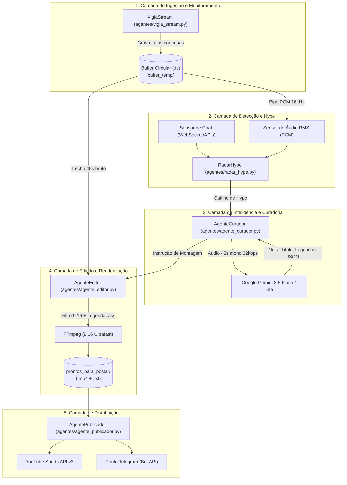

# 📐 Arquitetura do Sistema - ClipHunter AI

Este documento detalha o desenho arquitetural, o ciclo de vida dos agentes assíncronos e os fluxos de dados do **ClipHunter AI**.

---

## 1. Visão Geral da Arquitetura Multiagente

O ClipHunter AI adota o padrão de **Pipeline Multiagente Assíncrono Desacoplado**, operando sob o loop de eventos `asyncio` em conjunto com subprocessos dedicados para tarefas de mídia de baixo nível (FFmpeg).

---

## 2. Contratos e Responsabilidades dos Agentes

### 2.1. `VigiaStream` (`agentes/vigia_stream.py`)
- **Responsabilidade:** Identificar canais ao vivo (YouTube, Kick, Twitch) via `yt-dlp` e manter o buffer circular local.
- **Gravação Silenciosa:** Invoca o FFmpeg com `-c copy`, gerando blocos de 30 segundos (`seg_%05d.ts`) sem sobrecarga de CPU.
- **Proteção de Armazenamento:** Rotina periódica a cada 15 segundos descarta blocos com mais de 5 minutos de idade ou quando a pasta atinge o limite configurado (padrão: 500MB).
- **Auto-Calibração de Câmera:** Extrai um frame da live e aciona a visão multimodal para inferir o enquadramento ideal da webcam (`[ymin, xmin, ymax, xmax]`).

### 2.2. `RadarHype` (`agentes/radar_hype.py`)
- **Responsabilidade:** Detecção em tempo real de momentos virais por meio de fusão de sensores.
- **Sensor de Áudio (RMS):** Leitura de áudio cru PCM 16-bit mono. Calcula a média móvel dos últimos 60 segundos e dispara quando `RMS_atual > 2.5 * media_movel`.
- **Sensor de Chat:** Conexão assíncrona ao fluxo de chat. Monitora a taxa de mensagens por segundo e pesquisa palavras-gatilho de impacto emocional.
- **Mecanismo Pós-Pico:** Aguarda 20 segundos adicionais após o gatilho para capturar a reação completa do streamer antes de fechar o lote de segmentos.

### 2.3. `AgenteCurador` (`agentes/agente_curador.py`)
- **Responsabilidade:** Avaliação semântica e transcrição das falas.
- **Extração Ultra-Leve:** Extrai um arquivo de áudio mono de 45 segundos codificado a 32kbps (~180KB).
- **Chamada Multimodal:** Envia o arquivo de áudio e as mensagens de chat ao Google Gemini via SDK oficial `google-genai`.
- **Saída Estruturada:** Retorna estritamente um JSON contendo aprovação (`true/false`), nota (1 a 10), gancho magnético, descrição e array de legendas com timestamps sincronizados.

### 2.4. `AgenteEditor` (`agentes/agente_editor.py`)
- **Responsabilidade:** Montagem do vídeo vertical 9:16 (1080x1920) em FFmpeg.
- **Filtro Complexo:**
  - Webcam recortada e centralizada no terço superior (1080x672).
  - Gameplay ocupando os dois terços inferiores (1080x1248).
  - Legendas dinâmicas sobrepostas via formato `.ass` de alto contraste.
- **Controle de Performance:** Renderização limitada a `-preset ultrafast -threads 2` para manter estabilidade em CPUs sem aceleração gráfica.

### 2.5. `AgentePublicador` (`agentes/agente_publicador.py`)
- **Responsabilidade:** Gestão de envios e conformidade com limites de API.
- **Controle de Cota YouTube:** Registro permanente em `config/historico_uploads.json`. Limita a 6 envios em uma janela móvel de 24 horas para respeitar o limite gratuito de 10.000 unidades diárias da API.
- **Ponte Telegram:** Envia o arquivo de vídeo e metadados diretamente para o celular do usuário via bot do Telegram, permitindo compartilhamento orgânico imediato em outras redes.

---

## 3. Gestão de Falhas e Resiliência

| Possível Falha | Mecanismo de Recuperação |
| :--- | :--- |
| Live cai ou streamer encerra | VigiaStream detecta ausência de pacotes e transiciona para o próximo streamer da lista de prioridade. Auto-stop após 10 minutos de inatividade geral. |
| Chat desconecta ou sofre bloqueio | Radar continua funcionando 100% via sensor de áudio RMS e amostragem periódica. |
| Cota do modelo principal de IA esgotada | Cascata automática para modelo mais leve (`gemini-3.5-flash-lite`). Se offline, aplica fallback baseado em regras com título padrão. |
| Interrupção forçada (`Ctrl + C`) | Handlers de sinal encerram subprocessos FFmpeg imediatamente sem corromper arquivos ou deixar processos zumbis. |
