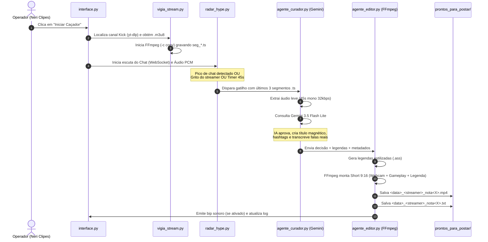
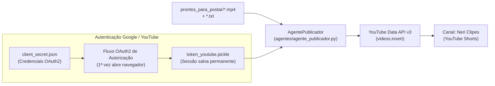

# 📋 Relatório Técnico Completo: ClipHunter AI
*Documento de Alinhamento e Especificação Técnica para o Canal "Neri Clipes"*

---

## 1. 📂 Árvore de Diretórios e Análise de Arquivos

Abaixo está a estrutura completa e higienizada do repositório (excluindo `.venv` e caches):

```text
GTA6_ClipHunter/
│
├── .antigravity/
│   └── rules.md                # Regras de arquitetura e restrições de hardware para agentes
├── .vscode/
│   └── settings.json           # Configurações do VS Code
│
├── agentes/
│   ├── __init__.py             # Inicializador do pacote de agentes
│   ├── vigia_stream.py         # Vigia da live (yt-dlp + FFmpeg buffer circular .ts + autocalibração IA)
│   ├── radar_hype.py           # Gatilho duplo (Chat Kick WebSocket + Áudio RMS PCM contínuo)
│   ├── agente_curador.py       # Curadoria multimodal (Gemini 3.5 Flash Lite + transcrição de falas reais)
│   └── agente_editor.py        # Montagem do Short 9:16 (FFmpeg ultrafast -threads 2 + legendas .ass)
│
├── config/
│   └── streamers.json          # Perfis de streamers (Kick URLs, hashtags, palavras-gatilho, webcam_crop)
│
├── prontos_para_postar/        # Destino final dos vídeos .mp4 (1080x1920) e arquivos .txt de metadados
├── buffer_temp/                # Diretório volátil de trabalho (fatias seg_*.ts, mp3 mono, legendas .ass)
│
├── .env                        # Variáveis de ambiente ativas (chaves de API, parâmetros de teste)
├── .env.example                # Template de configuração de variáveis
├── .gitignore                  # Arquivos ignorados no controle de versão
├── requirements.txt            # Dependências Python instaladas
├── README.md                   # Documentação geral do sistema
├── abrir_janela.bat            # Script de inicialização silenciosa da interface Windows (sem terminal)
├── interface.py                # Interface gráfica desktop moderna em CustomTkinter (Dark Theme)
├── main.py                     # Orquestrador assíncrono principal (Pipeline ponta a ponta)
├── calibrar_webcam.py          # Utilitário CLI auxiliar para plotar grade de coordenadas na live
└── calibracao_webcam.jpg       # Frame de calibragem gerado para inspeção
```

### Detalhamento dos Módulos Principais

* **`interface.py` (Central de Operações GUI):**
  * Desenvolvido com `customtkinter` em tema escuro (`Dark`).
  * Executa o bot em uma thread dedicada (`BotRunner`) desacoplada do loop da interface gráfica, garantindo que a janela nunca congele.
  * Oferece: seletor de streamers configurados ou digitação de canal avulso; seleção manual da posição da webcam ou detecção inteligente em 1 clique via IA (`🎯 Detectar Webcam Agora`); botão para gerar pré-visualização de 5 segundos (`👁️ Prévia`); botão para ativar/desativar legendas dinâmicas; botão para modo de teste rápido; botão para ligar/desligar o bip sonoro (`🔔`/`🔕`) em tempo real; botão para abrir a pasta de vídeos no Windows Explorer; e caixa de logs filtrada e amigável.
* **`main.py` (`OrquestradorClipHunter`):**
  * Orquestrador de alto nível que instancia e gerencia o ciclo de vida dos agentes.
  * Coordena a transição de dados entre os agentes usando `asyncio` e um `Lock` de processamento para evitar edições simultâneas que sobrecarreguem a CPU.
* **`agentes/vigia_stream.py` (`VigiaStream`):**
  * Extrai a URL `.m3u8` do stream ao vivo na Kick através do `yt-dlp` sem precisar abrir navegadores pesados.
  * Inicia um subprocesso oculto do FFmpeg (`-c copy`) que fatia a live continuamente em blocos de 30 segundos (`seg_%05d.ts`) dentro de `buffer_temp/`.
  * **Proteção de SSD:** Possui uma rotina assíncrona que roda a cada 15 segundos eliminando automaticamente segmentos com mais de 4 minutos ou sempre que a pasta ultrapassar 400MB.
  * **Auto-Calibração IA (`detectar_webcam_ia`):** Captura um frame da live e envia ao Gemini, que retorna a caixa delimitadora (`[ymin, xmin, ymax, xmax]`) exata da câmera do streamer para qualquer criador.
* **`agentes/radar_hype.py` (`RadarHype`):**
  * **Sensor 1 (Chat Kick):** Conexão direta com o WebSocket Centrifugo da Kick (`realtime.us-east-1.platform.kick.com`). Mede velocidade de mensagens/segundo e caça palavras-gatilho de reações (`KKKK`, `CLIP`, `MDS`, `INSANO`) e assuntos de hype.
  * **Sensor 2 (Áudio RMS):** Pipe de áudio PCM contínuo via FFmpeg com cálculo matemático via `numpy`. Dispara se a energia sonora ultrapassar 2.5x a média móvel dos últimos 60 segundos (gritos, comemorações, sustos).
  * **Sensor 3 (Modo Teste / Amostragem):** Dispara periodicamente (a cada 45 segundos no modo de teste) para garantir que cortes sejam gerados mesmo em momentos de chat lento.
* **`agentes/agente_curador.py` (`AgenteCurador`):**
  * Extrai rapidamente um arquivo de áudio mono a 32kbps (~180KB) dos últimos 45 segundos via FFmpeg.
  * Consulta o Google Gemini com cascata de modelos (`gemini-3.5-flash-lite` $\rightarrow$ `gemini-3.1-flash-lite` $\rightarrow$ `gemini-2.5-flash`), garantindo que o bot nunca pare por estouro de cota da API gratuita.
  * Retorna um JSON estrito contendo: aprovação (`true/false`), nota de viralidade (1 a 10), título com gancho magnético, descrição pronta com hashtags e array de legendas sincronizadas (`inicio`, `fim`, `texto`) com a transcrição real das falas em português.
* **`agentes/agente_editor.py` (`AgenteEditor`):**
  * Concatena os segmentos `.ts` brutos sem recodificação prévia.
  * Gera um arquivo de legendas `.ass` estilizado para celulares (fonte Arial Black, amarelo vibrante, contorno preto grosso de 4.5 pixels).
  * Aplica o filtro complexo vertical 9:16 (1080x1920):
    * **Topo (1080x672):** Recorte da webcam do streamer com centralização horizontal e respiro vertical balanceado (`(in_h-672)/2`).
    * **Base (1080x1248):** Gameplay central em tela cheia.
    * **Sobreposição:** Legendas dinâmicas sincronizadas sobre a gameplay.
  * Renderiza com `libx264` utilizando estritamente `-preset ultrafast -threads 2` (uso de CPU controlado).
  * Move o arquivo de forma atômica para `prontos_para_postar/*.mp4` e salva o `.txt` de metadados correspondente.

---

## 2. 📦 Dependências, Ambiente e Tecnologias

### A. Bibliotecas Python (`requirements.txt`)
* `google-genai` ($\ge 1.0.0$): SDK moderno e oficial do Google para os modelos Gemini 3.x (visão e áudio multimodal).
* `yt-dlp` ($\ge 2025.1.0$): Resolução rápida de fluxos de vídeo HLS/m3u8 da Kick.
* `aiohttp` ($\ge 3.10.0$) & `websockets` ($\ge 13.0$): Comunicação assíncrona com os servidores da Kick e APIs externas.
* `numpy` ($\ge 1.26.0$): Cálculo vetorial ultra-rápido de picos de RMS no áudio.
* `Pillow` ($\ge 10.4.0$): Manipulação e inspeção de frames e imagens.
* `customtkinter` ($\ge 6.0.0$): Interface gráfica moderna em tema escuro nativo do Windows.
* `python-dotenv` ($\ge 1.0.0$): Leitura de credenciais do `.env`.
* `pydantic` ($\ge 2.7.0$): Validação e estruturação de dados.

### B. Ambiente e Infraestrutura
* **Interpretador:** Python 3.11+ no ambiente virtual `.venv`.
* **FFmpeg:** Versão 9.0.2 instalada e detectada automaticamente no PATH do sistema ou pacotes do WinGet. Executa com a flag `CREATE_NO_WINDOW` no Windows (sem janelas de prompt pretas piscando na tela do usuário).
* **Consumo de Hardware:**
  * RAM total: **< 1.5 GB**.
  * CPU: **Moderada** (FFmpeg limitado a 2 threads com `-preset ultrafast`).
  * SSD: **Protegido** (buffer circular de gravação limitado a no máximo 400MB).

---

## 3. 🔄 Fluxo de Operação Ponta a Ponta



### O Formato do Arquivo de Metadados Gerado (`.txt`):
```text
PAULINHO O LOKO FALANDO DE GTA 6?!

O que você acha disso?
Deixe nos comentários!

#paulinho #paulinholoko #gta6 #gtavi #clips #shorts

--- Detalhes do Corte ---
Streamer: Paulinho o LOKO (@paulinholokobr)
Nota Viralidade: 8/10
Data/Hora: 16/11/2026 23:25:14
Origem do Gatilho: PICO_CHAT_KICK
Legendas Sincronizadas: Sim
```

---

## 4. 📊 Matriz de Maturidade do Projeto

| Componente / Módulo | Status Atual | Detalhes Técnicos |
| :--- | :---: | :--- |
| **Interface Gráfica (GUI)** | ✅ **100% Operacional** | CustomTkinter com botões de Iniciar, Parar, Prévia 5s, Auto-calibração IA, Seletor de canal e Toggle de bip sonoro. |
| **Captura de Live (Kick)** | ✅ **100% Operacional** | `yt-dlp` resolvendo stream ao vivo, gravação circular com zero perda de pacotes e limpeza de SSD. |
| **Radar de Hype Duplo** | ✅ **100% Operacional** | Chat Centrifugo da Kick + Áudio RMS contínuo + Modo de Teste a cada 45s. |
| **Curadoria & Legendas IA** | ✅ **100% Operacional** | Gemini 3.5 Flash Lite transcrevendo diálogos reais em blocos de 2 a 5 palavras sincronizadas. Cascata de 3 modelos para zero falhas de cota. |
| **Edição e Renderização 9:16** | ✅ **100% Operacional** | Recorte de webcam no topo, gameplay na base e legendas amarelas com borda preta grossa, sem janelas pretas popup. |
| **Enquadramento de Câmera** | ✅ **100% Operacional** | Bounding box dinâmica da IA testada e validada para câmeras largas (Paulinho) e compactas (Bkinho). |
| **Suporte a Twitch e YouTube** | 🟡 **Arquitetado (Pendente)** | Estudo técnico concluído. yt-dlp suporta ambas as plataformas; adaptadores de chat (IRC Twitch e pytchat YouTube) mapeados para implementação. |
| **Upload YouTube Shorts** | 🔴 **Não Implementado** | Nenhum código de envio para API do YouTube existe no projeto atualmente. Postagem ainda é manual. |
| **Upload TikTok / Reels** | 🔴 **Não Implementado** | Não integrado. Canal Neri Clipes depende de postagem manual do arquivo gerado. |

---

## 5. 🚀 Plano de Implementação: Upload Automático (Canal Neri Clipes)

O próximo passo do projeto é fechar o ciclo de automação: **assim que o vídeo for renderizado em `prontos_para_postar/`, ele deve ser enviado automaticamente como Short no canal do YouTube "Neri Clipes"**.

### Arquitetura da Integração com o YouTube



### Passo a Passo Recomendado de Execução

#### Fase 1: Módulo `AgentePublicador` (`agentes/agente_publicador.py`)
1. **Adicionar dependências no `requirements.txt`:**
   * `google-api-python-client`
   * `google-auth-oauthlib`
   * `google-auth-httplib2`
2. **Configuração de Credenciais:**
   * O usuário baixa o arquivo `client_secret.json` do Google Cloud Console (projeto com a API *YouTube Data API v3* ativada).
   * O arquivo fica salvo na raiz do projeto (`client_secret.json`).
3. **Autenticação com Persistência:**
   * Na primeira execução, o script abre uma aba no navegador para o usuário fazer login no canal **Neri Clipes** e autorizar permissão de upload (`https://www.googleapis.com/auth/youtube.upload`).
   * O token de acesso e refresh token são salvos em `token_youtube.pickle`. A partir daí, **o bot nunca mais pede login**, autenticando-se silenciosamente em segundo plano.
4. **Método de Envio (`publicar_short`):**
   * Lê o arquivo `.mp4` e o arquivo `.txt` gerado pelo editor.
   * Extrai o título (linha 1 do `.txt`) e a descrição com hashtags (linhas 3 a 6 do `.txt`).
   * Executa upload com *resumable upload* para evitar falhas se a conexão oscilar.
   * Permite configurar o status do vídeo:
     * `public`: Vai direto ao ar como Short público.
     * `unlisted`: Fica disponível por link para conferência antes de liberar.
     * `private`: Fica como rascunho seguro.

#### Fase 2: Integração com a Interface Gráfica (`interface.py`)
1. Adicionar uma nova seção no painel de opções:
   * **Checkbox:** `☁️ Publicar automaticamente no YouTube Shorts (Neri Clipes)`.
   * **Seletor de Privacidade:** `Público`, `Não Listado` ou `Rascunho (Privado)`.
   * **Botão:** `🔑 Conectar Conta YouTube (Neri Clipes)`.
2. Feedback no log:
   * Mensagem: `📤 Enviando Short para o canal Neri Clipes: 'TÍTULO DO VÍDEO' (Aguarde...)`.
   * Mensagem de sucesso: `🎉 Short publicado com sucesso no YouTube! Link: https://youtu.be/ID_DO_VIDEO`.

#### Fase 3: Piloto Assistido para Redes Sociais (TikTok e Instagram)
Como as APIs de postagem direta do TikTok e Meta exigem aprovação burocrática de contas empresariais e frequentemente aplicam restrições de alcance (*shadowban*) em envios automatizados via API não oficial:
1. **Notificação Automática via Bot do Telegram / Discord:**
   * Assim que o corte é renderizado, o bot dispara o vídeo `.mp4` + título + hashtags diretamente para o Telegram pessoal do operador do canal.
   * O operador abre o celular e compartilha no TikTok e Reels em 2 toques, com engajamento orgânico 100% seguro.
